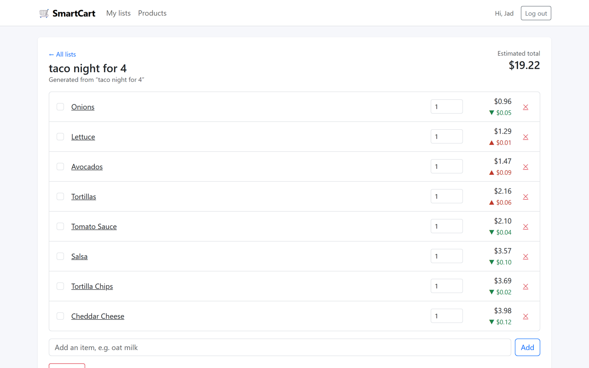
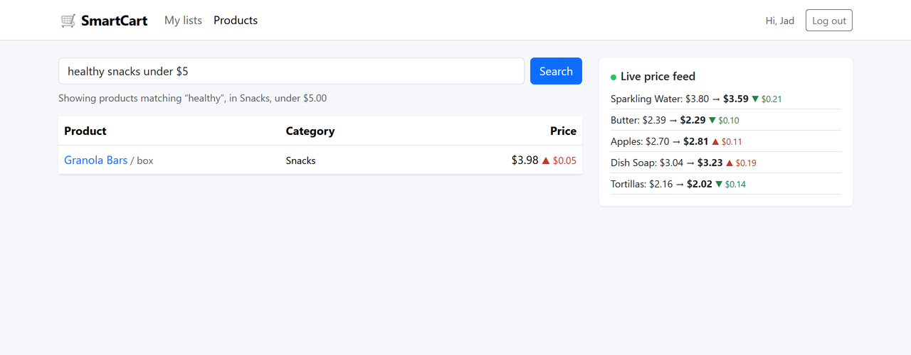

# 🛒 SmartCart — AI-Based Shopping Assistant

SmartCart is a full-stack shopping assistant that turns a sentence like *"taco night for 4"* into a priced shopping list, understands natural-language product searches like *"healthy snacks under $5"*, recommends products based on what you usually buy, and streams live price changes to the browser.

**Stack:** React · Bootstrap · Node.js · Express · MongoDB (Mongoose) · OpenAI API · JWT authentication · Server-Sent Events

## Screenshots





## Features

| Feature | How it works |
| --- | --- |
| **Smart list generation** | `POST /api/lists/generate` sends the prompt and the product catalog to the OpenAI API, which returns a list of items. Each item is matched to a catalog product so the list has prices and an estimated total. |
| **Natural-language search** | The query is converted into structured filters (`keywords`, `category`, `minPrice`, `maxPrice`) by the OpenAI API, then products are ranked by relevance and price. |
| **Personalized recommendations** | Suggests products that complement the items in your lists, with a short reason for each. |
| **Real-time price tracking** | A background job updates prices and records a price history per product. Changes are pushed to the UI over Server-Sent Events, so list totals and price badges update live. |
| **JWT authentication** | Register / log in with bcrypt-hashed passwords; lists are private to their owner. |

**Works without an API key.** If `OPENAI_API_KEY` is not set, search, list generation and recommendations fall back to a rule-based engine (keyword/tag matching and price parsing), so the app runs fully offline.

> **Note on prices:** the price feed is simulated (random walk within ±30% of each product's base price). The tracker in `server/src/services/priceTracker.js` is isolated so it can be swapped for a real store API.

## Project structure

```
smartcart/
├── client/                 # React + Vite + Bootstrap
│   └── src/
│       ├── api/            # fetch wrapper, auth context, live price hook (EventSource)
│       ├── components/     # NavBar, PriceChart (SVG), PriceChange
│       └── pages/          # Auth, Lists, List detail, Products, Product detail
└── server/                 # Express + MongoDB
    ├── src/
    │   ├── models/         # User, Product (with price history), ShoppingList
    │   ├── routes/         # auth, products, lists
    │   ├── services/       # ai.js (OpenAI + fallbacks), matcher.js, priceTracker.js, seeder.js
    │   └── middleware/     # JWT auth
    └── test/               # API tests (node:test + supertest + in-memory MongoDB)
```

## Getting started

Requirements: Node.js 20+ and MongoDB (local or [MongoDB Atlas](https://www.mongodb.com/atlas)).

```bash
# 1. API
cd server
cp .env.example .env        # set JWT_SECRET, and optionally OPENAI_API_KEY
npm install
npm run dev                 # http://localhost:4000 - seeds 46 sample products on first run

# 2. Web app (new terminal)
cd client
npm install
npm run dev                 # http://localhost:5173
```

### Tests

```bash
cd server
npm test
```

The tests start an in-memory MongoDB and cover auth, natural-language search (with and without a mocked OpenAI client), list generation, item updates, ownership checks, recommendations and the price tracker.

On first run, `mongodb-memory-server` downloads a MongoDB binary (~600 MB). On a slow connection you can point it at an existing `mongod` instead:

```bash
MONGOMS_SYSTEM_BINARY=/path/to/mongod npm test
```

## API overview

| Method | Endpoint | Description |
| --- | --- | --- |
| POST | `/api/auth/register` | Create an account, returns a JWT |
| POST | `/api/auth/login` | Log in, returns a JWT |
| GET | `/api/auth/me` | Current user |
| GET | `/api/products?q=` | List products / natural-language search |
| GET | `/api/products/:id` | Product with price history |
| GET | `/api/products/recommendations` | Personalized picks (auth) |
| GET | `/api/products/prices/stream` | Live price updates (SSE) |
| GET/POST | `/api/lists` | Get / create lists (auth) |
| POST | `/api/lists/generate` | AI-generated list from a prompt (auth) |
| GET/PATCH/DELETE | `/api/lists/:id` | Read / rename / delete a list (auth) |
| POST | `/api/lists/:id/items` | Add an item (auth) |
| PATCH/DELETE | `/api/lists/:id/items/:itemId` | Check, change quantity, remove (auth) |

## Author

**Jad Obeid** — [LinkedIn](https://www.linkedin.com/in/jad-obeid-dev) · [GitHub](https://github.com/jad-obeidd)
